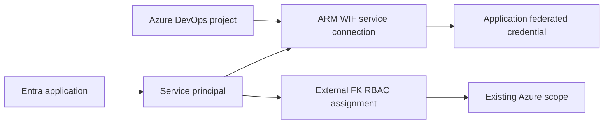

# Example 01: Project with OIDC Service Connection

In this first Azure DevOps example, we create a **project and passwordless Azure Resource Manager service connection** using **Terraform / OpenTofu**.

The example composes `terraform-az-fk-devops` with `terraform-az-fk-rbac` to establish federated trust and grant the pipeline identity read access to an existing Azure scope.

---

## 🧭 Architecture Overview

The Entra application and service principal identify the pipeline workload. Azure DevOps returns the service connection's OIDC issuer and subject; the application federated credential trusts those exact claims with audience `api://AzureADTokenExchange`. External RBAC determines the resulting Azure access.



This example creates:

- One Azure DevOps project
- One single-tenant Entra application and service principal
- One ARM service connection using workload identity federation
- One application federated identity credential
- One role assignment through the dedicated `terraform-az-fk-rbac` module

The organization, subscription and target scope already exist. No stored Azure client secret, source repository resource, pipeline definition, YAML, networking or deployment target is created.

---

## 🎯 Why this example exists

Before introducing Key Vault-linked configuration, it is useful to understand how **the project, service connection, Entra trust and Azure RBAC fit together**.

This example focuses on:

- Passwordless Azure authentication from Azure Pipelines
- Exact service connection issuer and subject matching
- Explicit application and service principal ownership
- Separate ownership of federated trust and Azure role assignments
- A minimal read-only permission for later runtime verification

---

## 🚀 Deployment Steps

### Prerequisites

- An existing Azure DevOps organization and permissions to create projects, service connections and variable groups
- An existing Azure subscription and Resource Group, with permission to assign Azure roles
- Entra permissions to create and manage applications, service principals and federated credentials
- Bootstrap authentication configured externally for the AzureDevOps, AzureAD and AzureRM providers

Copy `terraform.tfvars.example` to ignored `terraform.tfvars` and replace the placeholder identifiers. Set `rbac_scope` to an existing scope in the supplied subscription. The example defaults to `Reader` for authenticated reads; select a narrowly scoped deployment role for a later pipeline that needs writes. Keep provider credentials outside HCL and tfvars.

```bash
cp terraform.tfvars.example terraform.tfvars
# Replace the nonsecret placeholder identifiers before continuing.
tofu init
tofu fmt -check
tofu validate
```

To provision the reviewed configuration in your own environment:

```bash
tofu apply
```

`devops.tf` composes the local module and `rbac.tf` composes the external RBAC module at a reviewed commit. `providers.tf`, `variables.tf` and `outputs.tf` provide the runnable wrapper. Authorize only the intended pipeline to use the connection.

---

## 🖼️ Azure Portal View

No Azure Portal screenshots have been collected because this example has not been deployed during verification. After deployment, inspect the project service connection, Entra application's federated credential and the target scope's role assignment.

---

## ✅ Test Results

Static verification completed on **October 14, 2026** with OpenTofu **1.11.6**:

| Check | Result |
|---|---|
| `tofu fmt -check` | Passed |
| `tofu init` | Passed |
| `tofu validate` | Passed |

Full command output, including the initial sandbox plugin error and successful rerun, is recorded in [VERIFICATION.md](../../VERIFICATION.md).

No plan, apply or runtime token exchange was executed. To verify passwordless authentication after deployment, authorize an independently managed Azure Pipeline to use the connection, then run a WIF-capable Azure task that reads the selected scope. Pipeline definitions and YAML belong to the separately built [terraform-az-fk-devops-pipeline](https://github.com/foggykitchen/terraform-az-fk-devops-pipeline) sibling and the caller's repository.

The outputs expose the service connection ID/name and exact issuer/subject. Trust creation and the RBAC assignment are dependencies of the example's connection ID output; Entra and RBAC propagation can still take time. See the root [Provider Notes](../../README.md#provider-notes) before issuer conversion or connection renaming.

---

## 🧹 Cleanup

```bash
tofu destroy
```

Review project contents before deletion. Destroying this example removes the project, application/service principal, federated trust and its composed role assignment; the existing subscription and Resource Group remain externally managed.

---

## 🪪 License

Licensed under the **Universal Permissive License (UPL), Version 1.0**.
See [LICENSE](../../LICENSE) for details.

© 2026 [FoggyKitchen.com](https://foggykitchen.com) - Cloud. Code. Clarity.
