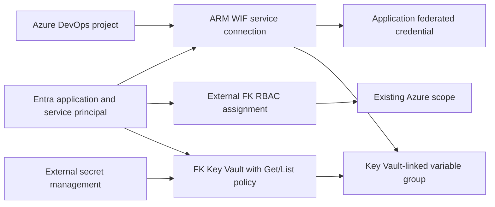

# Example 02: Project with Key Vault Variable Group

In this second Azure DevOps example, we extend the **project and OIDC service connection** with a **Key Vault-linked variable group** using **Terraform / OpenTofu**.

The example composes `terraform-az-fk-devops`, `terraform-az-fk-rbac` and `terraform-az-fk-key-vault`. Only existing secret names are mapped into Azure DevOps; secret values are populated outside Terraform.

---

## 🧭 Architecture Overview

The project, application, service principal and WIF trust follow Example 01. The Key Vault module grants that service principal Get/List access through vault access policies. Once the vault contains enabled secrets, the variable group links their names through the passwordless ARM connection.



This example creates:

- The project, Entra identity and federated trust from Example 01
- An external FK RBAC assignment for the existing target Azure scope
- One Key Vault through `terraform-az-fk-key-vault`, in an existing Resource Group
- A Get/List access policy for the pipeline service principal
- One Key Vault-linked variable group when `link_variable_group = true`

The vault uses public endpoint access and vault access policies. The provider must be able to enumerate enabled secret metadata through Azure DevOps. No secret values, pipeline definition, YAML, networking or deployment targets are created.

The vault receives the service principal output, and the variable group receives the vault name output. Keep these resource-level dependencies; adding module-wide `depends_on` between the DevOps and vault modules would introduce a cycle.

---

## 🎯 Why this example exists

This example introduces **shared pipeline configuration without putting secret values in Terraform**.

It focuses on:

- Key Vault-linked variable groups supported by AzureDevOps provider 1.16.0
- WIF-based access to Key Vault using the same ARM service connection
- Explicit Get/List permissions and externally populated secrets
- A staged workflow that satisfies the provider's existing-secret check
- Restricted group access, with individual pipeline authorization

---

## 🚀 Deployment Steps

### Prerequisites

- An existing Azure DevOps organization and permissions to create projects, service connections and variable groups
- An existing Azure subscription and Resource Group, with permission to assign Azure roles
- Entra permissions to create and manage applications, service principals and federated credentials
- Bootstrap authentication configured externally for the AzureDevOps, AzureAD and AzureRM providers

Copy `terraform.tfvars.example` to ignored `terraform.tfvars` and replace the placeholder identifiers. Set `rbac_scope` to an existing scope in the supplied subscription. The example defaults to `Reader` for authenticated reads; select a narrowly scoped deployment role for a later pipeline that needs writes. Keep provider credentials outside HCL and tfvars.

### Stage 1 — Create the project, trust and vault

Keep the initial settings:

```hcl
link_variable_group = false
secret_names        = []
```

Initialize and validate the configuration:

```bash
cp terraform.tfvars.example terraform.tfvars
# Replace the nonsecret placeholder identifiers before continuing.
tofu init
tofu fmt -check
tofu validate
```

To provision the reviewed first-stage configuration in your own environment:

```bash
tofu apply
```

### Stage 2 — Populate the vault and enable the link

Have an authorized operator populate the vault through an external secret-management process. The pipeline identity has only Get/List permissions; the operator needs separate secret-write permission. Never put secret values in Terraform or tfvars.

Set the existing enabled secret names and enable the variable group:

```hcl
link_variable_group = true
secret_names        = ["existing-application-secret"]
```

Reconcile the updated configuration:

```bash
tofu apply
```

The AzureDevOps provider checks that named secrets exist when creating the group, so an empty new vault cannot satisfy the second stage. Allow time for Entra/access-policy propagation and ensure Azure DevOps can reach the vault endpoint. The Library service's network path may differ from the agent's path.

Authorize the intended pipeline to use both the connection and variable group. `allow_access` remains false. Existing secret value rotations are fetched at runtime; adding or removing mapped names requires updating `secret_names`. Only secrets are supported, not keys or certificates. The provider's `search_depth` defaults to 20 and can be increased through the root module contract.

`devops.tf`, `rbac.tf` and `key_vault.tf` separate control-plane, RBAC and vault composition. The external modules are pinned to reviewed commits.

---

## 🖼️ Azure Portal View

No Azure Portal or Azure DevOps screenshots have been collected because this example has not been deployed during verification. After both stages, inspect the vault access policy, Entra federated credential and the Library variable group's secret-name mappings.

---

## ✅ Test Results

Static verification completed on **October 14, 2026** with OpenTofu **1.11.6**:

| Check | Result |
|---|---|
| `tofu fmt -check` | Passed |
| `tofu init` | Passed |
| `tofu validate` | Passed |

Full command output, including the initial sandbox plugin error and successful rerun, is recorded in [VERIFICATION.md](../../VERIFICATION.md).

No plan, apply or runtime token exchange was executed. To verify passwordless authentication after deployment, authorize an independently managed Azure Pipeline to use the connection, then run a WIF-capable Azure task that reads the selected scope. Pipeline definitions and YAML belong to the separately built [terraform-az-fk-devops-pipeline](https://github.com/foggykitchen/terraform-az-fk-devops-pipeline) sibling and the caller's repository.

The outputs expose the service connection ID/name and exact issuer/subject. Trust creation and the RBAC assignment are dependencies of the example's connection ID output; Entra and RBAC propagation can still take time. See the root [Provider Notes](../../README.md#provider-notes) before issuer conversion or connection renaming.

---

## 🧹 Cleanup

```bash
tofu destroy
```

Review project contents and vault data before deletion. Key Vault soft deletion and name retention can delay name reuse. The existing subscription, Resource Group and target deployment resources remain externally managed.

---

## 🪪 License

Licensed under the **Universal Permissive License (UPL), Version 1.0**.
See [LICENSE](../../LICENSE) for details.

© 2026 [FoggyKitchen.com](https://foggykitchen.com) - Cloud. Code. Clarity.
