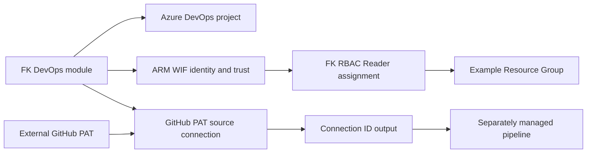

# Example 03: Project with GitHub Service Connection

In this Azure DevOps example, we add a **GitHub source service connection** to the project and passwordless ARM foundation using **Terraform / OpenTofu**.

The example composes `terraform-az-fk-devops` and `terraform-az-fk-rbac`. The GitHub resource stays inside the DevOps module; no raw endpoint resource is declared in the example.

---

## 🧭 Architecture Overview



This example creates the project, Entra identity and federated trust, an ARM WIF connection, one GitHub PAT connection, a Resource Group and a composed Reader role assignment. It creates no repository, pipeline definition or YAML content. The ARM and GitHub connections authenticate to different services.

---

## 🎯 Why this example exists

This example demonstrates optional shared source-host access owned by the DevOps module, following the external-connection responsibility of the OCI counterpart. `github_service_connection_ids["hello_world"]` is the composition point for `terraform-az-fk-devops-pipeline`.

---

## 🚀 Deployment Steps

Use an existing Azure DevOps organization/subscription and externally configured AzureDevOps, AzureAD and AzureRM bootstrap authentication. The caller needs project/connection administration, Entra identity creation and Azure RBAC permissions. Supply a GitHub PAT with source access through `AZDO_GITHUB_SERVICE_CONNECTION_PAT` in the execution environment. Do not put the token in code, tfvars or shell history.

The endpoint provider stores the PAT in state. Use a protected backend or secured local state. GitHub App installation and interactive OAuth consent are external workflows; this example creates a PAT connection.

```bash
cp terraform.tfvars.example terraform.tfvars
# Replace nonsecret placeholders and configure credentials externally.
tofu init -backend=false
tofu fmt -check
tofu validate
```

Provision only after reviewing the configuration and credential permissions. Individual pipeline permissions are managed by the pipeline sibling; this example does not grant access to all pipelines.

---

## 🖼️ Azure DevOps Portal View

No deployment screenshots have been collected. After deployment, inspect the project’s Service connections view for both `fk-azure-oidc` and `fk-github-hello-world`. Never expose PATs in screenshots.

---

## ✅ Test Results

The configuration was checked with `tofu fmt -check`, `tofu init -backend=false` and `tofu validate`. No apply or pipeline execution was performed for this example. Static checks do not verify GitHub PAT scope, remote repository access or ARM runtime token exchange.

---

## 🧹 Cleanup

No cloud resources were created during static verification. After a future deployment, review project contents and Resource Group contents before cleanup. Destruction removes the managed project, connections, identity/trust, role assignment and Resource Group. The external organization, subscription and GitHub repository remain independently managed.

---

## 🪪 License

Licensed under the **Universal Permissive License (UPL), Version 1.0**.
See [LICENSE](../../LICENSE) for details.

---

© 2026 [FoggyKitchen.com](https://foggykitchen.com) - Cloud. Code. Clarity.
